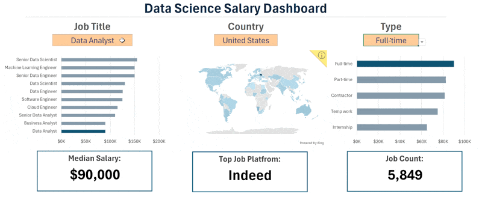

# Excel Salary Dashboard  



## Introduction

Created an interactive **Excel Salary Dashboard** to explore and analyze salary trends in the data job market. The dashboard helps users compare salaries across different job roles and locations, making it easier to understand compensation patterns and gain insights into the data analytics and data science job market.  

## Dashboard File

You can find the completed Excel dashboard here:

[Salary_Dashboard.xlsx](Salary_Dashboard.xlsx)

## Excel Skills Used

The following Excel skills and features were applied in this project:

- **Charts and Data Visualization** – Presented salary trends through visual representations.
- **Formulas and Functions** – Performed calculations and analyzed salary data.
- **Data Validation** – Created interactive filters to explore dashboard results.
- **Dashboard Design** – Organized key insights into an interactive and user-friendly layout.

## Dataset Overview

The dataset contains information about data-related job opportunities in 2023, including:

- **Job Titles** – Different roles in the data industry.
- **Salaries** – Compensation information for various positions.
- **Locations** – Geographic distribution of job opportunities.
- **Skills** – Skills associated with different job roles.

## Dashboard Build

### 📉 Charts

#### 📊 Data Science Job Salaries – Bar Chart


- 🛠️ **Excel Features:** Used Excel's bar chart functionality and number formatting to present salary data clearly.
- 🎨 **Design Choice:** Selected a horizontal bar chart to make salary comparisons across different job titles easier.
- 📊 **Data Organization:** Sorted job titles in descending order of median salary for better readability.
- 💡 **Key Learning:** Learned how charts help identify salary trends and compare earning potential across different job roles.

#### 🗺️ Country Median Salaries – Map Chart

  

## 🧮 Formulas and Functions

### 💰 Median Salary by Job Titles

```excel
=MEDIAN(
IF(
    (jobs[job_title_short]=A2)*
    (jobs[job_country]=country)*
    (ISNUMBER(SEARCH(type,jobs[job_schedule_type])))*
    (jobs[salary_year_avg]<>0),
    jobs[salary_year_avg]
)
)
```


- 🛠️ **Excel Features:** Applied Excel's map chart functionality to visualize median salaries across different countries.
- 🎨 **Design Choice:** Used different colours to represent salary levels across geographical regions.
- 📊 **Data Representation:** Visualized median salaries for countries with available data.
- 👁️ **Visual Enhancement:** Used geographical visualization to make international salary comparisons easier to understand.
- 💡 **Key Learning:** Learned how map charts can reveal geographical salary differences and help identify high- and low-paying regions.
