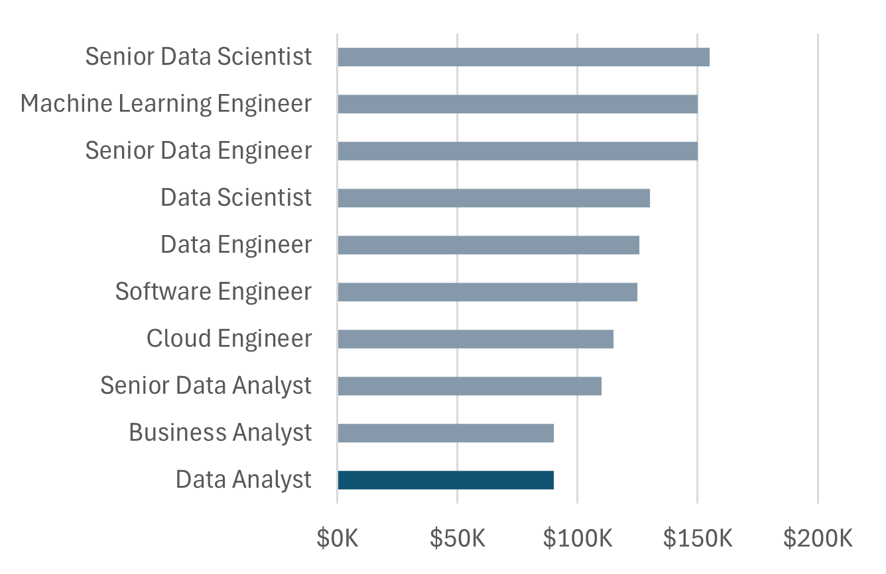
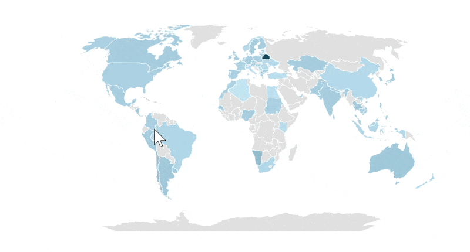
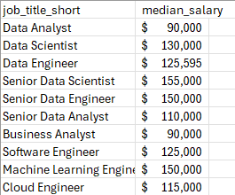
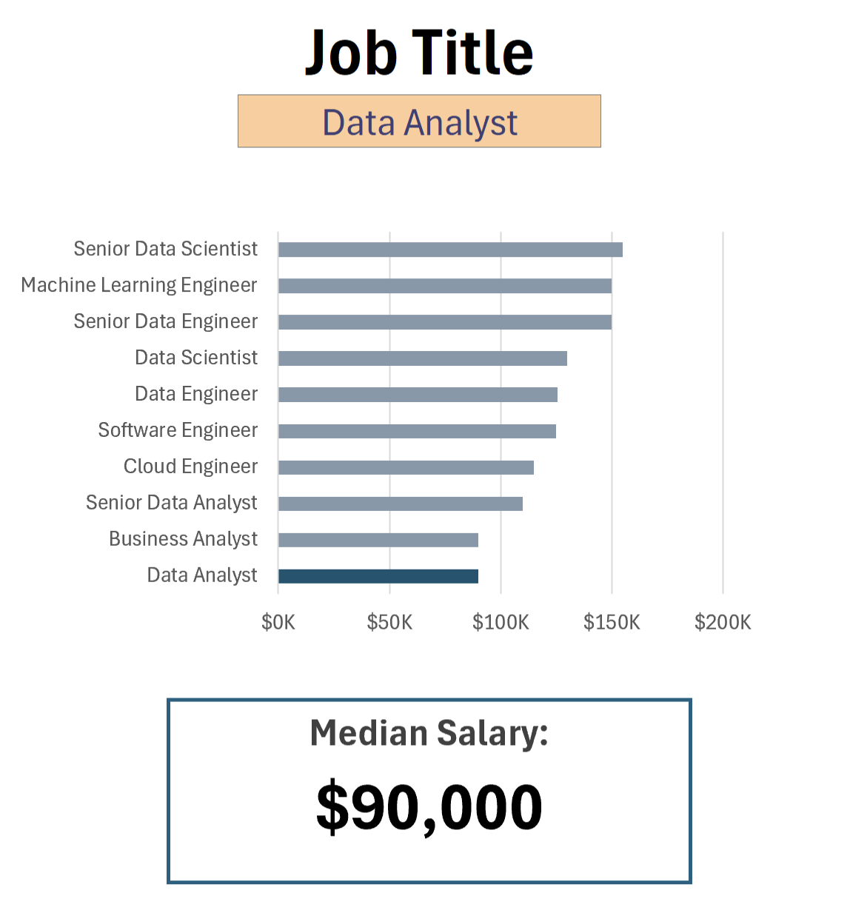
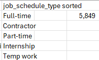
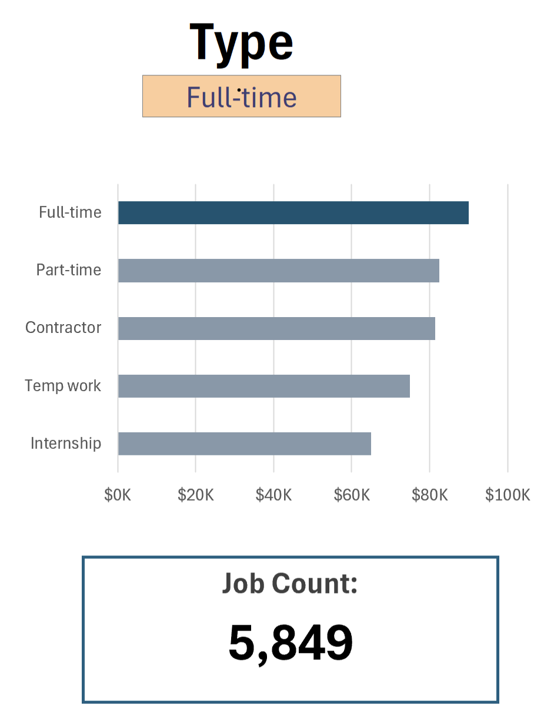
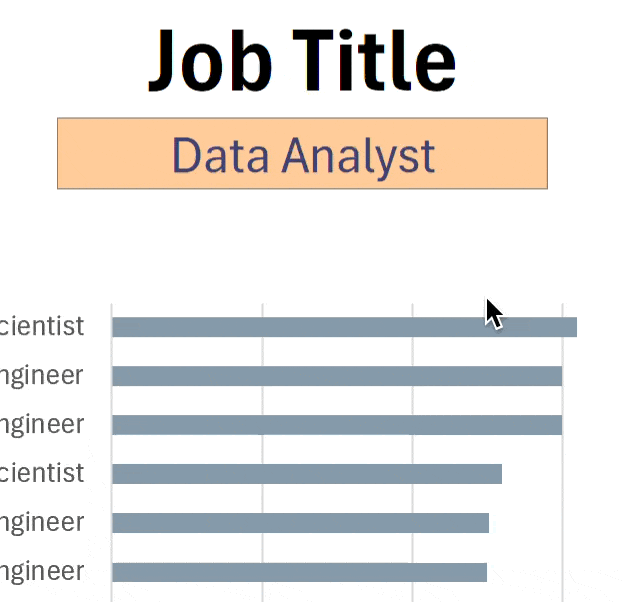

# Excel Salary Dashboard  


## Introduction

Created an interactive **Excel Salary Dashboard** to explore and analyze salary trends in the data job market. The dashboard helps users compare salaries across different job roles and locations, making it easier to understand compensation patterns and gain insights into the data analytics and data science job market.  

## Dashboard File

You can find the completed Excel dashboard here:

[Salary_Dashboard.xlsx](Salary_Dashboard.xlsx)

## Excel Skills Used

The following Excel skills and features were applied in this project:

- **Charts and Data Visualization** – Presented salary trends through visual representations.
- **Formulas and Functions** – Performed calculations and analyzed salary data.
- **Data Validation** – Created interactive filters to explore dashboard results.
- **Dashboard Design** – Organized key insights into an interactive and user-friendly layout.

## Dataset Overview

The dataset contains information about data-related job opportunities in 2023, including:

- **Job Titles** – Different roles in the data industry.
- **Salaries** – Compensation information for various positions.
- **Locations** – Geographic distribution of job opportunities.
- **Skills** – Skills associated with different job roles.

## Dashboard Build

### 📉 Charts

#### 📊 Data Science Job Salaries – Bar Chart



-  **Excel Features:** Used Excel's bar chart functionality and number formatting to present salary data clearly.
-  **Design Choice:** Selected a horizontal bar chart to make salary comparisons across different job titles easier.
-  **Data Organization:** Sorted job titles in descending order of median salary for better readability.
-  **Key Learning:** Learned how charts help identify salary trends and compare earning potential across different job roles.

#### 🗺️ Country Median Salaries – Map Chart

  

##  Formulas and Functions

###  Median Salary by Job Titles

```excel
=MEDIAN(
IF(
    (jobs[job_title_short]=A2)*
    (jobs[job_country]=country)*
    (ISNUMBER(SEARCH(type,jobs[job_schedule_type])))*
    (jobs[salary_year_avg]<>0),
    jobs[salary_year_avg]
)
)
```

-  **Multi-Criteria Filtering:** Applied multiple conditions to filter salary data based on job title, country, and schedule type while excluding zero salary values.
-  **Array Formula:** Combined the `MEDIAN()` and `IF()` functions to calculate median salaries for records matching the selected criteria.
-  **Conditional Analysis:** Practiced using multiple criteria to extract relevant salary information for different job roles, countries, and employment types.
- ** Formula Purpose:** Used this formula to populate the salary table, dynamically calculating the median salary based on the selected job title, country, and schedule type.

🍽️ Background Table  



📉 Dashboard Implementation  



⏰ Job Schedule Types  
```
=FILTER(J2#,(NOT(ISNUMBER(SEARCH("and",J2#))+ISNUMBER(SEARCH(",",J2#))))*(J2#<>0))
```

-  Data Filtering: Used the FILTER() function to exclude job schedule entries containing "and" or commas, along with zero values.
-  Text Functions: Combined SEARCH() and ISNUMBER() to identify entries containing specific text patterns.
-  Dynamic List Generation: Used the spilled array reference J2# to filter the existing list dynamically.
-  Key Learning: Learned how to combine text-searching and logical functions to clean and organize data for dashboard development.
-  Formula Purpose: Generates a filtered list of individual job schedule types, which is used to populate the background table and support dashboard analysis.

🍽️ Background Table



📉 Dashboard Implementation

  

### ❎ Data Validation

#### 🔍 Filtered List

-  **Data Validation:** Applied Excel's Data Validation feature to create dropdown lists for the `Job Title`, `Country`, and `Type` filters.
-  **Controlled User Input:** Used predefined lists to ensure users select valid options while interacting with the dashboard.
-  **Error Prevention:** Learned how data validation helps prevent incorrect or inconsistent entries.
-  **Interactive Dashboard:** Made the dashboard more user-friendly by allowing users to explore salary information through dropdown selections.
-  **Key Learning:** Gained practical experience in using Data Validation to create interactive and easy-to-use Excel dashboards.



## Conclusion

Through this project, I gained hands-on experience in using Microsoft Excel to analyze salary trends in the data job market and build an interactive dashboard. I applied various Excel features, including charts, formulas and functions, and data validation to transform raw data into meaningful visual insights.

This project helped me strengthen my understanding of data analysis, data visualization, and dashboard design. It also gave me practical experience in exploring how job roles, geographical locations, and employment types influence salary trends.
