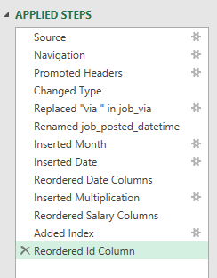
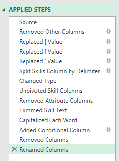
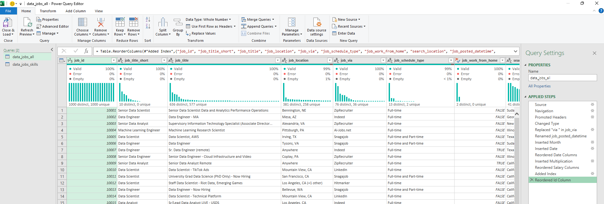
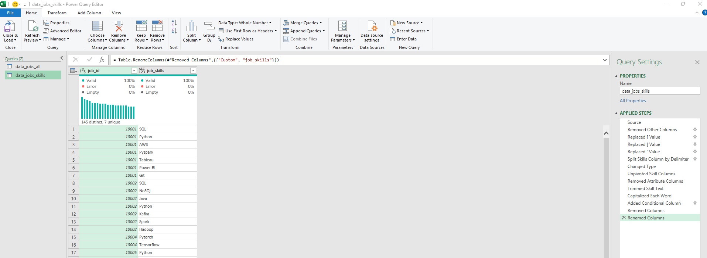
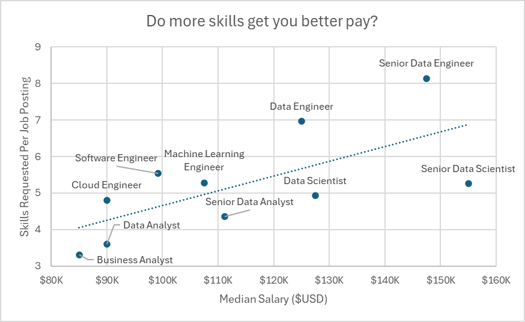
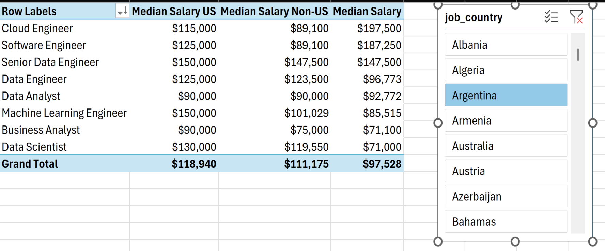
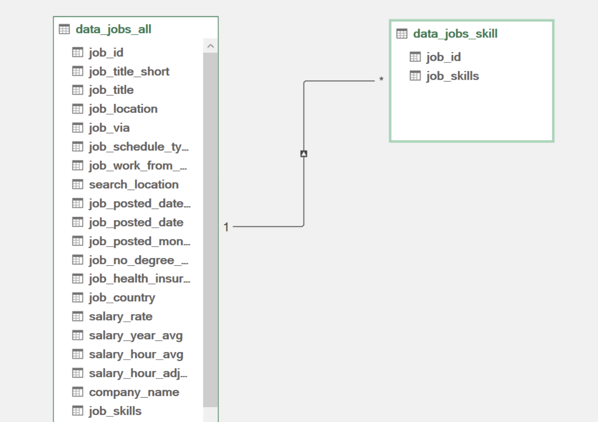
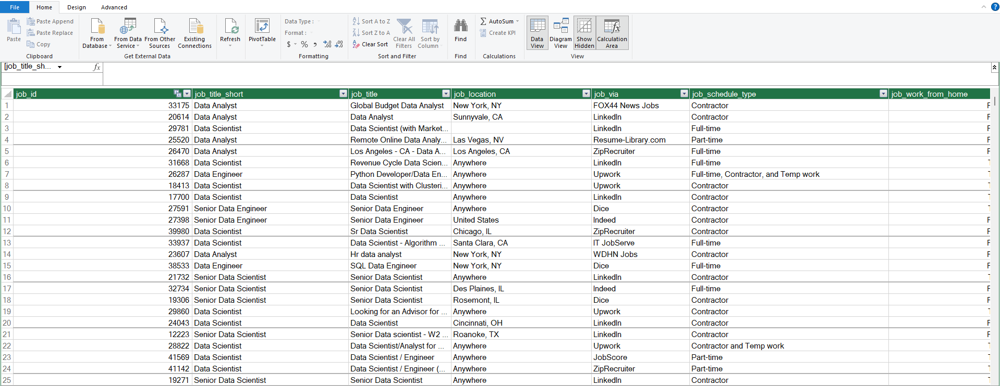
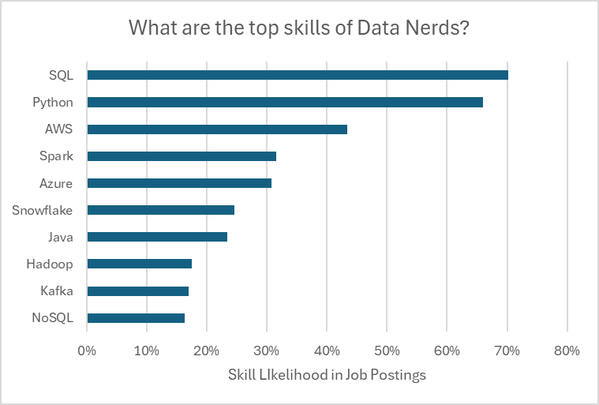
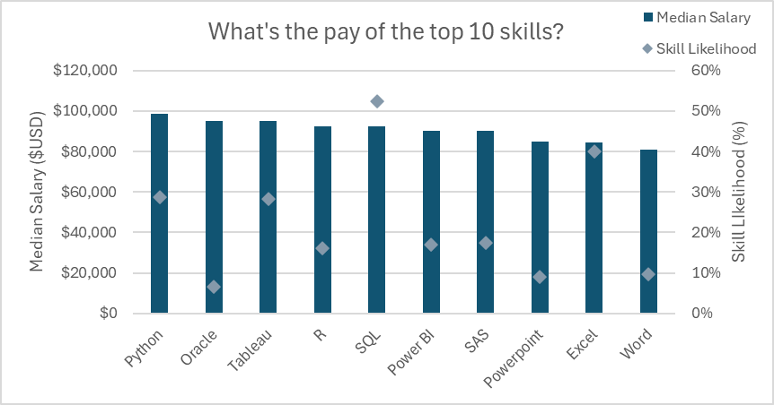

# Project 2 – Salary Data Analysis

## Introduction

Through this project, I explored the data science job market to understand how different skills, job roles, and geographical locations influence salary trends. My objective was to analyze real-world job market data and identify the skills that are commonly required and associated with higher-paying opportunities.

Using Microsoft Excel, I applied various data analysis tools and techniques to transform raw data into meaningful insights and better understand the relationship between skills and salaries in the data industry.

## Questions to Analyze

To explore the data science job market, I focused on the following questions:

1. Do more skills lead to higher salaries?
2. How do data job salaries vary across different regions?
3. What are the most in-demand skills among data professionals?
4. What are the median salaries associated with the top 10 skills?

## Excel Skills Used

The following Excel features and tools were explored and applied throughout this project:

-  **Pivot Tables**
-  **Pivot Charts**
-  **DAX (Data Analysis Expressions)**
-  **Power Query**
-  **Power Pivot**

## Dataset Overview

The dataset used in this project contains real-world data science job market information from 2023. It includes detailed information about job opportunities, salaries, locations, and skills required for different positions.

The dataset includes:

-  **Job Titles** – Different roles within the data industry.
-  **Salaries** – Annual salary information for various job positions.
-  **Locations** – Countries where job opportunities are available.
-  **Skills** – Technical and professional skills required for different roles.

---

## 1️⃣ Do More Skills Lead to Higher Salaries?

###  Skill Used: Power Query (ETL)

I used Power Query to extract, transform, and load the raw dataset into Excel, preparing it for further analysis.

####  Extract

I imported the original dataset (`data_salary_all.xlsx`) into Power Query and created two separate queries:

-  **data_jobs_all:** Contains information about data-related job postings.
-  **data_job_skills:** Contains the skills associated with each job ID.

####  Transform

I applied several data-cleaning steps to prepare both queries for analysis:

- Changed column data types to ensure consistency.
- Removed unnecessary columns.
- Cleaned text data by removing unwanted words.
- Trimmed excess whitespace from text values.

####  Data Cleaning – data_jobs_all



####  Data Cleaning – data_job_skills



####  Load

After cleaning and transforming the data, I loaded both queries into the Excel workbook to prepare them for further analysis.

####  Loaded Data – data_jobs_all



####  Loaded Data – data_job_skills



### 📊 Analysis

####  Insights

-  Observed a positive relationship between the number of skills required in job postings and median salaries, particularly for roles such as Senior Data Engineer and Data Scientist.
-  Noticed that roles such as Business Analyst, which generally require fewer specialized skills, tend to have lower median salaries compared to more technical positions.



####  Key Takeaway

This analysis helped me understand the importance of developing relevant technical skills and how a broader skill set can be associated with better-paying opportunities in the data industry.

---

## 2️⃣ How Do Data Job Salaries Vary Across Different Regions?

###  Skills Used: Pivot Tables and DAX

####  Pivot Table

I used PivotTables with the Data Model created through Power Pivot to organize and compare salary information.

The following steps were performed:

- Added `job_title_short` to the Rows area.
- Added `salary_year_avg` to the Values area.
- Created a DAX measure to calculate the median salary for jobs in the United States.

####  DAX Measure – Median Salary in the United States

```dax
Median US Salary :=
CALCULATE(
    MEDIAN(data_jobs_all[salary_year_avg]),
    data_jobs_all[job_country] = "United States"
)
```

####  DAX – Median Salary

I also created a general DAX measure to calculate the median annual salary across the dataset.

```dax
Median Salary :=
MEDIAN(data_jobs_all[salary_year_avg])
```

### 📊 Analysis

####  Insights

-  Observed that roles such as Senior Data Engineer and Data Scientist have relatively high median salaries in both US and international job markets.
-  Identified noticeable salary differences between US and non-US job opportunities, particularly for highly technical roles.
-  Understood how geographical location can influence salary levels across different data-related positions.



####  Key Takeaway

This analysis helped me understand how salary expectations vary across geographical regions and why location is an important factor when comparing job opportunities.

---

## 3️⃣ What Are the Most In-Demand Skills Among Data Professionals?

###  Skill Used: Power Pivot

####  Power Pivot

I used Power Pivot to create a Data Model by connecting the `data_jobs_all` and `data_job_skills` tables.

The following steps were performed:

-  **Data Model:** Added both tables to the Excel Data Model.
-  **Data Preparation:** Used the cleaned tables from Power Query for further analysis.
-  **Table Relationships:** Created a relationship between the two tables using the `job_id` column.
-  **Analysis Preparation:** Explored the Power Pivot interface and its features to organize data and create measures.

####  Data Model



####  Power Pivot Menu



### 📊 Analysis

####  Insights

-  Found that SQL and Python are among the most frequently requested skills in data-related job postings, highlighting their importance in data analysis and processing.
-  Observed that cloud technologies such as AWS and Azure are also commonly required, reflecting the growing importance of cloud computing and data infrastructure.



####  Key Takeaway

Through this analysis, I gained a better understanding of the most in-demand technical skills in the data industry. It also helped me identify the technologies worth focusing on while building my skills for future data analytics opportunities.

---

## 4️⃣ What Is the Pay Associated with the Top 10 Skills?

###  Skill Used: Advanced Charts (Pivot Chart)

#### 📈 Pivot Chart

I created a combination PivotChart to compare the median salaries and likelihood of different skills using data from my PivotTable.

The chart combines two types of visualizations:

-  **Primary Axis:** Displayed median salary using a Clustered Column Chart.
-  **Secondary Axis:** Represented skill likelihood (%) using a Line Chart with Markers.

I also customized the chart to improve its presentation:

- Added chart and axis titles.
- Removed unnecessary chart lines.
- Changed the line markers to diamond shapes.
- Adjusted the chart layout for better readability.

### 📊 Analysis

####  Insights

-  Observed that skills such as Python, Oracle, and SQL are associated with relatively higher median salaries.
-  Noticed that skills such as PowerPoint and Word have comparatively lower median salaries and skill likelihood in the analyzed dataset.



####  Key Takeaway

This analysis helped me understand how different technical skills relate to salary levels and demand in the job market. It also highlighted the importance of focusing on relevant technical skills such as Python and SQL when preparing for data-related career opportunities.

---

## Conclusion

Through this project, I gained practical experience in analyzing real-world data science job market data using Microsoft Excel. I explored various Excel tools, including Power Query, Power Pivot, PivotTables, PivotCharts, and DAX, to clean, organize, model, and analyze data.

The analysis helped me understand the relationship between technical skills and salaries, geographical salary differences, and the most frequently requested skills in the data industry.

This project strengthened my understanding of data analysis and visualization while giving me hands-on experience in using advanced Excel features to extract meaningful insights from raw data.
