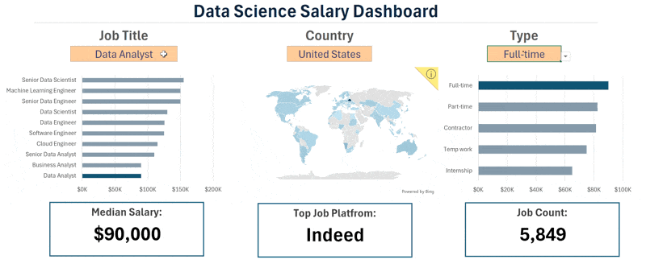
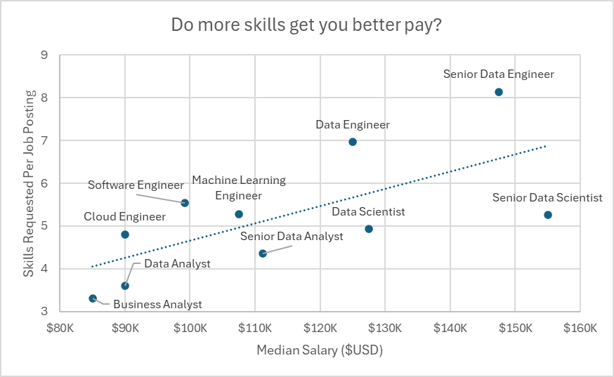
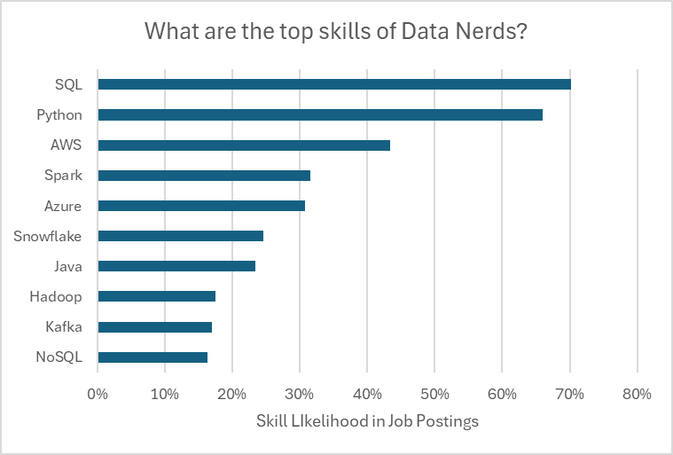

# My Excel Projects for Data Analytics  

This repository contains all the project files to access my work .  

## Salary Dashboard  

Created an interactive Salary Dashboard using Microsoft Excel to analyze job market data, explore salary distributions across various job roles, and compare compensation based on different factors. The project aims to provide valuable insights into salary trends and help users make informed career decisions.

[Check out my work here](Project-1_Salary_Dashboard)

## Salary Data Analysis

This project focuses on exploring the data science job market to identify in-demand skills, analyze salary trends, and understand how different skills and job roles influence earning potential. The analysis aims to provide valuable insights to help job seekers make informed career decisions and maximize their earning opportunities.

[Check out my work here](Project-2_Salary_Analysis)

  

